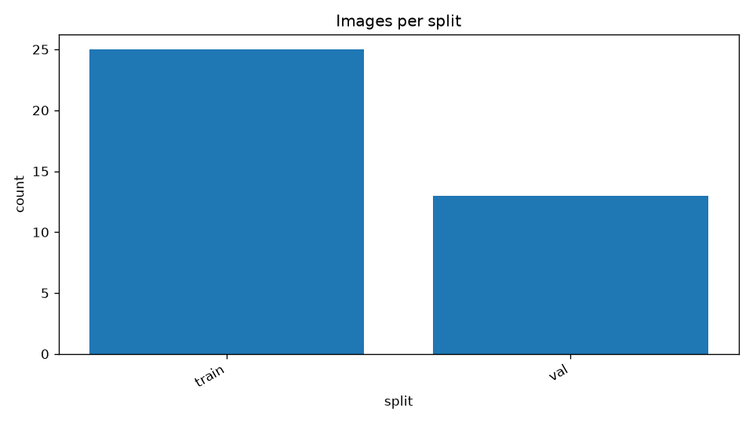
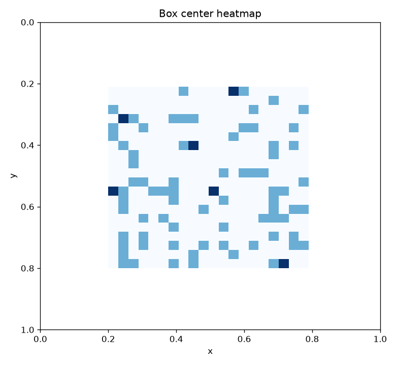
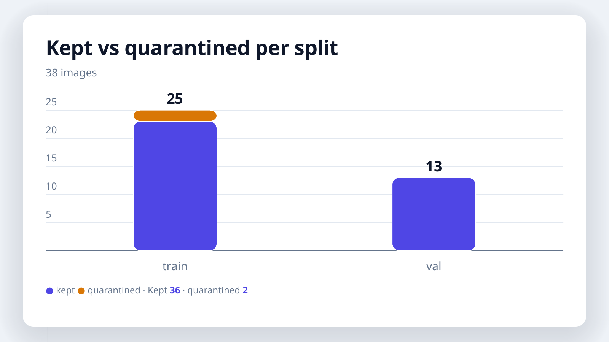

# VisionCleanse


[](https://github.com/MinhTriTM/vision-cleanse/actions/workflows/ci.yml)
[](https://www.python.org/)
[](LICENSE)

Phiên bản hiện tại: **0.2.0**.

Làm sạch dataset Computer Vision: phát hiện trùng lặp và ngăn rò rỉ
dữ liệu giữa Train / Val / Test.

## MVP gồm những gì

- **Vòng 1 — Exact match:** MD5 (hoặc SHA-256) cho file copy-paste y hệt.
- **Vòng 2 — Perceptual hash:** pHash và dHash tự cài đặt bằng Pillow +
  numpy (không cần gói `imagehash`). Bắt resize, đổi định dạng, nén
  lại JPEG. Không bắt crop sâu hay xoay — đó là vòng sau.
- **Logic split:** ưu tiên giữ `test > val > train`. Trùng trong cùng
  một split thì giữ ảnh có độ phân giải cao nhất, rồi file lớn nhất,
  rồi tên file nhỏ nhất (tất định, chạy lại ra cùng kết quả).
- **Xung đột nhãn:** cùng ảnh (hoặc ảnh rất giống) nhưng khác class thì
  **không tự xóa** — ghi vào `conflict_report.csv` để rà soát tay.
- **An toàn xóa:** mặc định là **dry-run** (chỉ báo cáo, không đụng
  file). Khi chạy `--apply`, file bị loại được **chuyển vào thư mục
  quarantine** (giữ nguyên cấu trúc thư mục) kèm `manifest.json`,
  không bao giờ xóa thẳng.
- **Đồng bộ annotation:** file nhãn YOLO `.txt` nằm cạnh ảnh được
  chuyển cùng ảnh vào quarantine. File COCO JSON (nếu truyền `--coco`)
  được xuất bản đã lọc, file gốc không bao giờ bị ghi đè.
- **Kiểm tra sức khỏe dataset (0.2.0):** ngoài trùng lặp, còn kiểm
  tra file rỗng 0 byte, file hỏng, ảnh trơn/đơn sắc, ảnh quá nhỏ,
  file lạ trong thư mục split, ảnh thiếu nhãn YOLO, nhãn YOLO mồ
  côi/sai định dạng/rỗng, trùng tên file khác nội dung, và trùng
  lặp trong nội bộ tập test. Kiểm tra YOLO tự bật khi thấy file
  `.txt` (hoặc ép bằng `--yolo`).
- **Ba ngôn ngữ (0.2.0):** thông báo CLI và tên các kiểm tra có
  tiếng Việt, tiếng Anh và tiếng Trung qua `--lang vi|en|zh`
  (mặc định `vi`). Key trong `report.json` luôn giữ tiếng Anh để
  máy đọc được.

## Kết luận "dataset sạch" nghĩa là gì

Khi báo cáo ghi `"clean": true`, nghĩa là **mọi kiểm tra đã bật đều
đạt** (không lỗi, không cảnh báo). Đây không phải cam kết tuyệt đối:
trùng gần đúng vốn là bài toán mờ và không công cụ nào bắt được lỗi
nhãn về mặt ngữ nghĩa. Báo cáo liệt kê đầy đủ từng kiểm tra đã chạy
nên kết luận này kiểm chứng được.

## Cài đặt

```bash
pip install -e .
```

Chỉ cần Pillow và numpy. Test dùng `unittest` có sẵn trong Python,
không cần pytest:

```bash
python -m unittest discover -s tests -v
```

(Nếu chưa `pip install -e .`, chạy với `PYTHONPATH=src`.)

## Dùng từ dòng lệnh

```bash
# Xem trước (dry-run, mặc định): không file nào bị di chuyển
vision-cleanse /path/to/dataset

# Chạy thật: chuyển file trùng vào quarantine
vision-cleanse /path/to/dataset --apply

# Thông báo tiếng Anh, kiểm tra YOLO luôn bật
vision-cleanse /path/to/dataset --apply --lang en --yolo

# Kèm đồng bộ COCO
vision-cleanse /path/to/dataset --apply --coco /path/to/annotations.json
```

Cấu trúc dataset kỳ vọng:

```
dataset/
  train/<class>/a.jpg   # hoặc train/a.jpg (không chia class)
  val/<class>/b.jpg
  test/<class>/c.jpg
```

Bố cục YOLO (chuẩn Ultralytics) — cấu trúc kỳ vọng:

```
dataset_root/
  images/train/img1.jpg
  images/train/img2.jpg
  images/val/img3.jpg
  labels/train/img1.txt
  labels/train/img2.txt
  labels/val/img3.txt
  data.yaml   # train: images/train, val: images/val, names: [cat, dog]
```

Tập `test` là tùy chọn: dataset chỉ có `train`/`val` vẫn chạy đủ
chức năng, và khi không có test thì ưu tiên giữ là `val > train`.

Các split không tồn tại sẽ được bỏ qua kèm cảnh báo. Báo cáo ghi ra
`vision_cleanse_report/report.json` và (nếu có xung đột nhãn)
`vision_cleanse_report/conflict_report.csv`.

## Dùng từ Python

```python
from vision_cleanse import clean

report = clean("/path/to/dataset", dry_run=True)
print(report["duplicate_groups"], report["to_quarantine"])

# Chạy thật
report = clean("/path/to/dataset", dry_run=False,
               quarantine_dir="/path/to/quarantine")
```

## Bố cục dataset hỗ trợ

Hai bố cục được tự nhận diện:

- **Classic:** `train/<class>/a.jpg` (hoặc `train/a.jpg`), nhãn YOLO
  `.txt` nằm cạnh ảnh.
- **YOLO:** `images/train/a.jpg` + `labels/train/a.txt` + `data.yaml`
  (tên class lấy từ `names` trong `data.yaml`). Khi quét ở chế độ
  này, file nhãn được chuyển vào quarantine giữ nguyên cây `labels/`.

## Biểu đồ

```bash
pip install vision-cleanse[charts]
vision-cleanse /path/to/dataset --charts
```

Xuất 24 biểu đồ PNG vào `<report-dir>/charts` (xem `docs/charts.md`):
tổng quan split/class, phân phối kích thước file, chiều ảnh, tỉ lệ,
diện tích; với nhãn YOLO: số box mỗi ảnh, box mỗi class, phân phối
w/h/diện tích box, scatter và heatmap tâm box, heatmap class × split;
và kết quả làm sạch: nhóm trùng theo phương pháp, file loại theo
split/lý do, vấn đề sức khỏe theo kiểm tra/mức độ, kept vs quarantined.
Biểu đồ nào không có dữ liệu sẽ được bỏ qua và ghi rõ lý do trong
`report.json` (không vẽ biểu đồ rỗng giả).

Ảnh mẫu (xem đủ 22 ảnh ở `docs/charts.md`):







## Ngưỡng

Một cặp ảnh được coi là trùng gần đúng khi pHash **hoặc** dHash nằm
trong ngưỡng (mặc định 10 trên hash 64-bit). Hai hash bổ sung nhau:
dHash đọc dấu gradient ngang nên rất ổn định trước nhiễu JPEG (đo
thực tế: khoảng cách 0 ngay cả ở JPEG quality 30, kể cả ảnh trơn
mà pHash trôi tới 16), còn pHash đọc cấu trúc tần số toàn cục nên
bắt được những thay đổi mà dHash mù (dHash chỉ so sánh trái-phải).
Luật OR thiên về recall; vì file chỉ bị chuyển vào quarantine kèm
báo cáo chứ không bị xóa thẳng nên người dùng vẫn rà soát được.
Hiệu chỉnh bằng `--phash-threshold` / `--dhash-threshold` sau khi đo
trên tập của bạn.

## Giới hạn của MVP (nói thẳng)

- Chưa bắt crop sâu, xoay, lật, đổi màu mạnh — các biến đổi này cần
  vòng đặc trưng sâu và xác minh hình học (SIFT + RANSAC) ở giai đoạn sau.
- Gom nhóm gần đúng hiện chạy pairwise O(n²). Với dataset rất lớn,
  hãy chạy theo từng split trước hoặc chờ vòng FAISS.
- Không có cam kết "sạch 100%": trùng gần đúng là bài toán mờ. Hãy đo
  precision/recall trên các biến thể tự sinh trước khi tin ngưỡng mặc định.
- File hỏng hoặc không đọc được sẽ bị bỏ qua và liệt kê trong
  `images_unreadable`, không làm crash pipeline.
